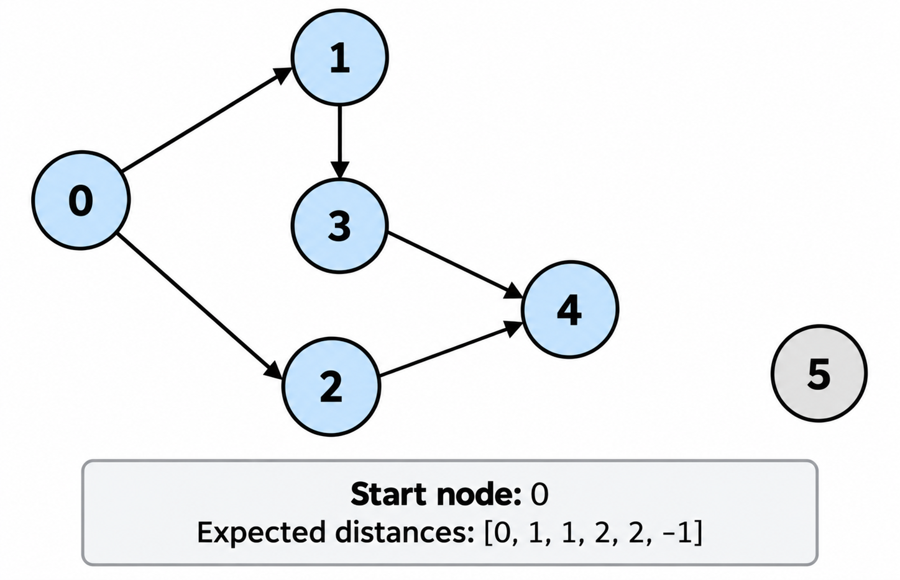
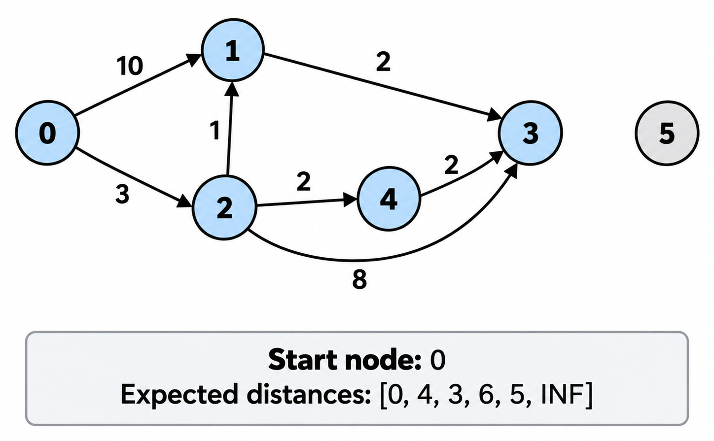
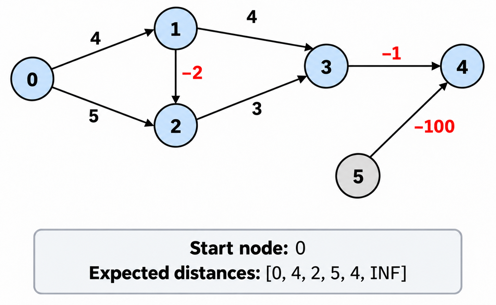
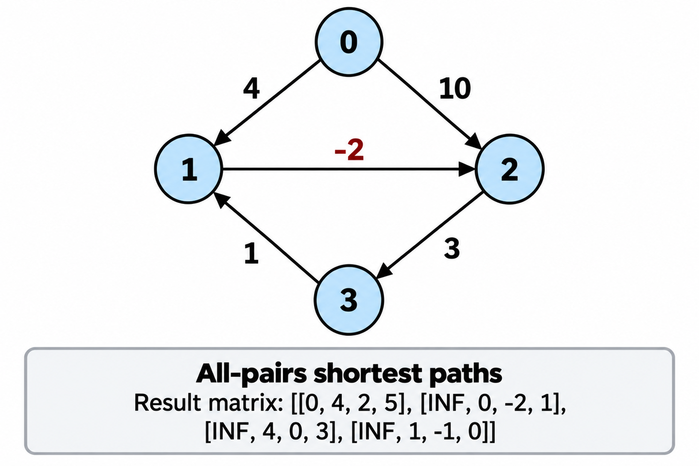

# 기본 구현 연습 (최단 경로 알고리즘)

개요
 

- 알고리즘의 **기본 구현을 반복적으로 연습**하기 위함
- 동일한 알고리즘을 여러 번 처음부터 구현해 보고, 미리 정의된 계약과 테스트를 통해 정확성을 검증

목적과 한계
 

- 알고리즘을 개념적, 시각적 또는 수학적으로 이해하더라도 실제 코드로 구현하는 데 어려움을 겪을 수 있음
- 특히 초기 코드나 입력이 없다면 구현을 어디서부터 시작해야 할지 막막할 수 있음
- 따라서 이러한 어려움을 줄이기 위해 메서드 시그니처와 초기 입력을 계약(Contract)으로 제공
- 구현의 출발점을 명확히 하고, 알고리즘의 핵심 로직을 코드로 옮기는 연습에 집중
- 알고리즘 선택, 문제 모델링, 자료구조 설계 등의 과정은 별도의 알고리즘 문제 풀이를 통해 보완해야 함

목표
 

- 알고리즘의 핵심 원리를 코드로 직접 구현할 수 있는 능력 기르기
- 반복 구현을 통한 자료구조 및 알고리즘의 숙달
- 구현 과정에서 발생하는 실수와 취약한 부분 파악
- 각 알고리즘의 시간 복잡도와 구현상의 특징 이해
- 이전 구현에 의존하지 않고 독립적으로 재구현하는 능력 확보

사용 방법
 

- 알고리즘에서 반드시 구현해야 하는 메서드가 인터페이스(템플릿)로 정의되어 있음
- 계약을 상속하는 구현 클래스를 회차별로 작성
- 모든 회차는 동일한 계약을 따르되, 알고리즘의 내부 로직을 처음부터 독립적으로 구현함
- 테스트를 통해 각 알고리즘의 정확성을 검증

원칙
 

- **계약은 고정하고 구현은 반복**: 동일한 요구사항을 반복해서 구현함으로써 숙련도를 확인
- **정답 코드보다 직접 구현하는 과정을 중시**: 막히는 부분이 있다면 원리를 다시 확인하고 스스로 해결하는 것을 우선
- **이전 구현은 보존하되 새로운 구현에 의존하지 않음**: 각 회차는 독립적인 연습 결과물임
- **테스트 통과와 알고리즘 이해를 구분**: 테스트 결과뿐 아니라 구현 근거와 복잡도도 설명할 수 있어야 함
- **반복할수록 구현의 정확성과 효율성을 개선**: 단순한 암기보다 알고리즘의 동작 원리에 대한 이해를 목표로 함

최종 목표

- 알고리즘의 동작 원리를 이해하고, 필요할 때 별도의 참고 자료 없이 정확하게 구현할 수 있는 상태에 도달하기

## BFS

## Dijkstra

## Bellman–Ford

## Floyd-Warshall

