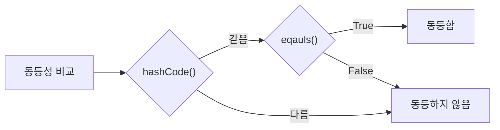

# equals()를 재정의하면 왜 hashCode()도 함께 재정의해야 할까?

## 재정의해야 하는 이유
- 두 객체의 동등성 비교 시 equals()와 hashCode() 메서드를 모두 사용하는 경우가 많기 때문이다.

## 설명
- HashSet이나 HashMap 같은 컬렉션은 항목을 찾을 때 hashCode() 결과가 같은지 우선 비교하고 그 다음 equals() 결과가 같은지 비교하여 동등 객체임을 확인한다.

- Streams.distinct(), Collectors.toSet()과 같은 경우도 객체의 정상적인 equals/hashCode 계약을 전제로 한다.

- equals()만 사용하는 기능에서는 hashCode() 재정의 여부가 직접적인 문제가 되지 않지만, 객체를 해시를 이용해 분류한 뒤 equals()로 동일성을 판단하는 기능에서는 둘의 계약이 반드시 맞아야 한다.